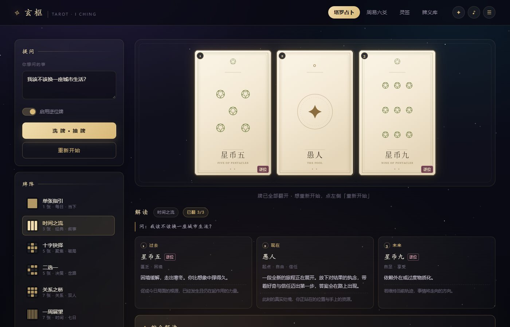

# 玄枢 · 塔罗与东方占卜

**在线体验：<https://nianovo33.github.io/xuanshu/>**

一个纯静态的占卜网页：78 张塔罗牌、九种牌阵、周易六爻、梅花易数、二十支灵签，外加可接入大模型的 AI 解读。

无构建步骤、无后端、无第三方依赖 —— 丢进 GitHub Pages 就能跑。



---

## 功能

| 模块 | 内容 |
|---|---|
| **塔罗** | 完整 78 张牌（22 大牌 + 权杖/圣杯/宝剑/星币 各 14 张），每张含正位 / 逆位牌义 |
| **牌阵** | 单张指引、时间之流、十字抉择、二选一、关系之桥、一周展望、凯尔特十字、灵魂之旅、月运之轮 |
| **解读** | 逐张翻牌，自动合成综合解读（大牌占比、花色能量、逆位比例、故事线） |
| **周易** | 三枚铜钱摇六爻，自动标动爻、生成本卦与变卦；另有梅花易数数字起卦 |
| **灵签** | 二十支签，签诗竖排，附解曰 |
| **AI 解读** | 塔罗 / 六爻 / 灵签三处均可调用大模型做深度解读（自备接口） |
| **其他** | 今日之牌、78 张牌义库、占卜记录（本地保存）、音效开关 |

所有牌面都是代码绘制的 SVG，没有一张图片，任意缩放都清晰。

---

## 部署到 GitHub Pages

### 1. 建仓库

新建一个 **Public** 仓库（私有仓库用 Pages 需要 GitHub Pro）。
仓库名随意，比如 `xuanshu`。

### 2. 上传文件

把仓库根目录需要的这些文件传上去：

```
index.html
style.css
data.js
app.js
.nojekyll
README.md
proxy/            ← 可选，AI 代理脚本
desktop/          ← 可选，桌面版打包工程
```

用命令行最省事：

```bash
git init
git add .
git commit -m "init"
git branch -M main
git remote add origin https://github.com/<你的用户名>/<仓库名>.git
git push -u origin main
```

`.gitignore` 已经排除了 `node_modules`、`dist`、`*.exe` 和本地笔记，不会把几百 MB 的构建产物推上去。

### 3. 打开 Pages

仓库页 → **Settings** → **Pages** → Source 选 **Deploy from a branch** →
Branch 选 **main**，目录选 **/(root)** → **Save**。

等一到两分钟，访问：

```
https://<你的用户名>.github.io/<仓库名>/
```

如果仓库名就叫 `<你的用户名>.github.io`，地址则是 `https://<你的用户名>.github.io/`。

> `.nojekyll` 的作用是跳过 Jekyll 处理，避免个别文件被忽略，同时加快构建。

### 4. 以后更新

改完文件 `git add . && git commit -m "update" && git push`，Pages 会自动重新发布。

---

## 本地预览

直接双击 `index.html` 也能用，但更推荐起个本地服务（行为与线上一致）：

```bash
python -m http.server 8000
# 打开 http://localhost:8000
```

---

## AI 解读怎么配

点右上角的 **✦** 打开设置，填三样东西：接口地址、模型名、API Key。

**站点本身不含任何密钥。** 每个访客填自己的 Key，只存在自己的浏览器 localStorage 里，不会上传到 Pages、也不会进占卜记录。

### 哪些服务商可以直接用

能不能用，取决于对方接口允不允许浏览器跨域（CORS）。实测结果：

| 服务商 | 浏览器直连 | 接口地址 | 模型示例 |
|---|---|---|---|
| DeepSeek | ✅ | `https://api.deepseek.com/chat/completions` | `deepseek-flash` |
| 月之暗面 Kimi | ✅ | `https://api.moonshot.cn/v1/chat/completions` | `moonshot-v1-8k` |
| 通义千问 | ✅ | `https://dashscope.aliyuncs.com/compatible-mode/v1/chat/completions` | `qwen-plus` |
| 智谱 GLM | ❌ 需代理 | `https://open.bigmodel.cn/api/paas/v4/chat/completions` | `glm-4-flash` |
| 本地 Ollama | ⚠️ 视浏览器 | `http://localhost:11434/v1/chat/completions` | `qwen2.5:7b` |

最后一行和 CORS 无关：GitHub Pages 是 https，从 https 页面请求 `http://localhost` 时，不同浏览器版本处理不一致（规范上 loopback 属于可信来源，但部分版本仍会拦截）。连不上就换 Worker 代理，或者本地直接开 `index.html` 使用。

### 用一个代理同时解决上面两种

仓库里带了 `proxy/cloudflare-worker.js`，白嫖 Cloudflare 的免费额度即可：

1. 打开 <https://dash.cloudflare.com> → **Workers & Pages** → **Create** → **Worker**
2. 把 `proxy/cloudflare-worker.js` 的内容整个粘进去，改第一行的 `UPSTREAM` 为你的服务商域名（默认已填 DeepSeek）
3. **Deploy**，拿到一个 `https://xxx.workers.dev` 地址
4. 回到玄枢的 AI 设置，接口地址填 `https://xxx.workers.dev/chat/completions`，模型和 Key 照旧

想省掉访客填 Key 的步骤，可以在 Worker 里挂一个加密变量（脚本里有注释说明）—— 但那样任何拿到地址的人都能消耗你的额度，慎用。

---

## 桌面版

`desktop/` 是 Electron 打包工程，产物是免安装的单文件 exe（约 71 MB）。

桌面版比网页版多两个好处：**没有跨域限制**（请求由主进程代发），**密钥存在本机应用目录**。

```bash
cd desktop
npm install
npm run dist
# 产物：desktop/dist/Xuanshu-1.0.0-portable.exe
```

`npm run dist` 前会自动把根目录的网页文件同步进 `desktop/app/`，不用手动复制。

exe 体积超过 GitHub 单文件建议值，建议放到 **Releases** 里而不是提交进仓库（`.gitignore` 已排除）。

---

## 目录结构

```
.
├─ index.html              页面结构（四个视图）
├─ style.css               视觉样式
├─ data.js                 78 张牌 / 64 卦 / 20 支签 / 9 种牌阵
├─ app.js                  交互与解读逻辑、AI 调用
├─ proxy/
│  └─ cloudflare-worker.js 可选：AI 请求代理
├─ desktop/                桌面版打包工程（Electron）
│  ├─ main.js              主进程：窗口、菜单、AI 代发
│  ├─ preload.js           渲染层与主进程的桥
│  ├─ scripts/sync.js      构建前同步网页文件
│  └─ build/icon.ico       应用图标
└─ .nojekyll
```

---

## 说明

- 所有解读（含 AI 生成内容）仅供自我觉察与娱乐参考，不构成医疗、法律或投资建议。
- 牌义、卦辞、签诗为现代白话重述，非古籍原文。
- 请勿把 API Key 写进代码或提交到仓库 —— 本项目通过设置面板由使用者自行填写。
